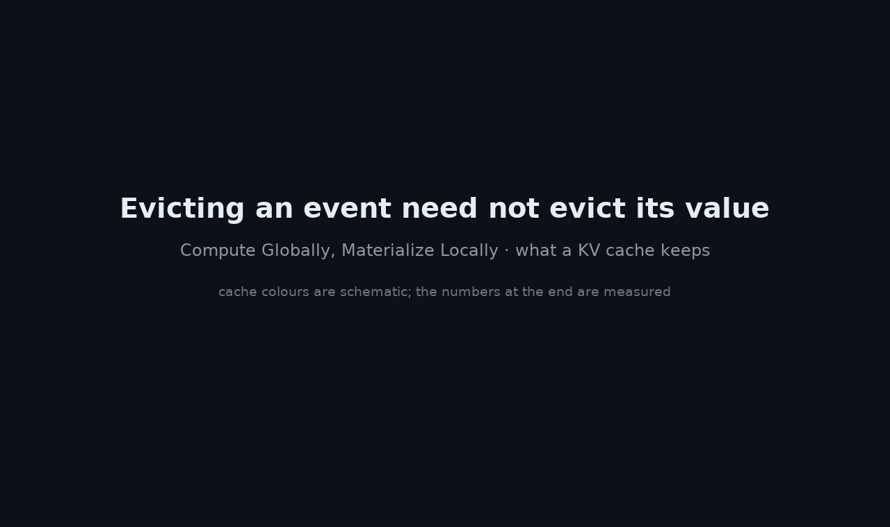
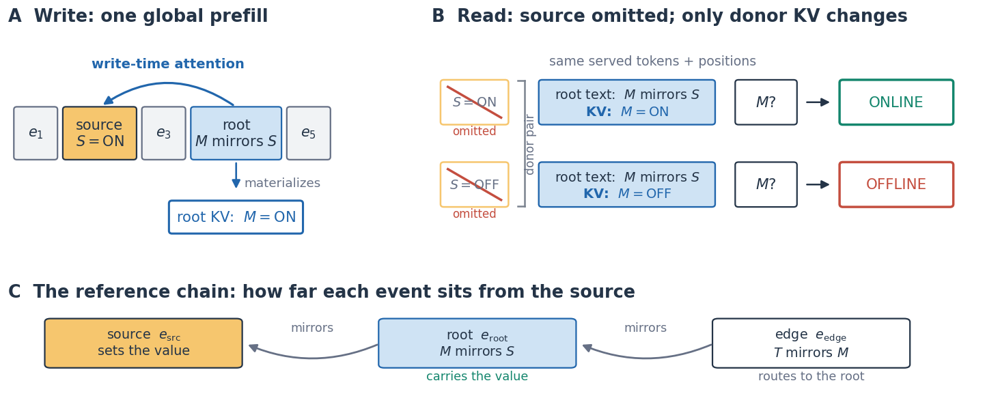
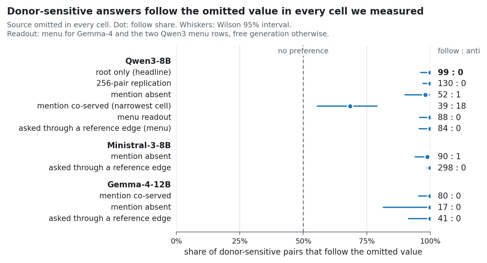
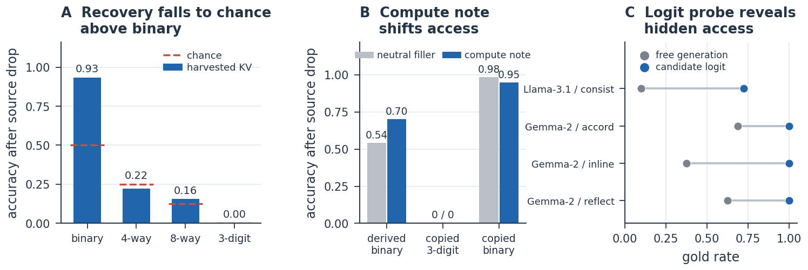
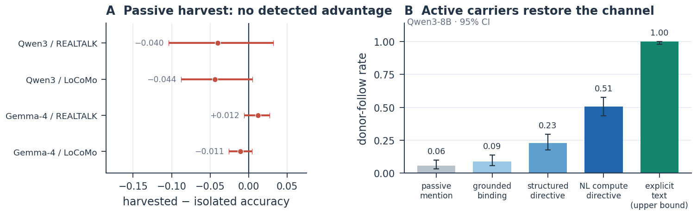
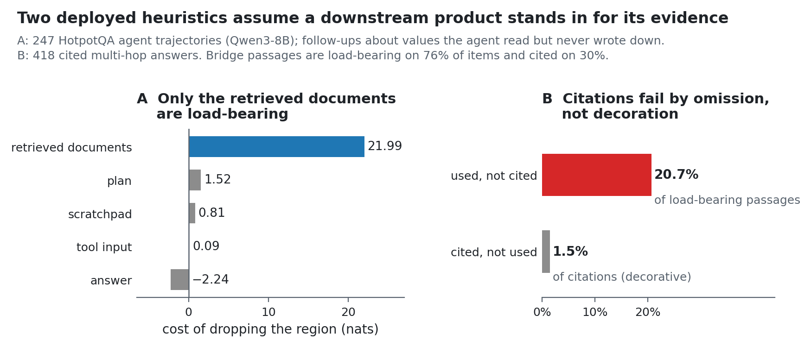

# Compute Globally, Materialize Locally
### The Memory Contract of Sparse Event-KV

[[Paper](https://arxiv.org/abs/2607.23693)] [[BibTeX](#citation)]

Zefeng Cai, Zerui Cai · independent researchers · this repository reproduces every experiment in the paper.



*A sketch of the main result. The cache cells and their colours are schematic: they show what the
measurements imply, not real activations. The numbers in the last scene are measured (§3 and
App. J). Built by [`figures/make_kv_demo.py`](figures/make_kv_demo.py).*

A common way to show that a cached event can be evicted is to drop it and check that accuracy holds.
That check cannot tell an unneeded event from one whose value already lives on in the rows that
remain. We show that a dropped value does live on there, which we call **semantic materialization**,
so "we dropped it and accuracy didn't fall" does not show the dropped event was unnecessary.

<picture>
  <source media="(prefers-color-scheme: dark)" srcset="assets/concept-dark.png">
  
</picture>

<picture>
  <source media="(prefers-color-scheme: dark)" srcset="assets/robustness-dark.png">
  
</picture>

`99:0` donor-sensitive pairs follow the omitted value on Qwen3-8B (*p* = 3.2×10⁻³⁰; 130:0 on a
256-pair replication) · `6% → 51%` donor-aligned recovery with one deliberate, answer-free write ·
`20.7% vs 1.5%` load-bearing passages left uncited vs decorative citations

Agent memory series: [VeraKV](https://github.com/oklen/VeraKV) — what to hand the model · [Compute Globally, Materialize Locally](https://github.com/oklen/Compute-Globally-Materialize-Locally) — what survives eviction · [TracePack](https://github.com/oklen/TracePack) — what survives compaction

## TL;DR

> We delete the observation an answer depends on and serve only a later event whose text never
> names the value. The model still answers with it: among donor-sensitive pairs the split is
> **99:0** on Qwen3-8B.

<details>
<summary><b>Abstract</b></summary>

Long-horizon agents increasingly reuse their KV cache as memory: a serving system keeps a subset of
cached entries and drops the rest. Eviction and episodic-memory schemes therefore rest on a premise
rarely tested directly, that a retained event is still informative once the observations that
produced it are gone. We test it by omitting one earlier observation from what is served, across
otherwise identical agent histories. Among items sensitive to that observation, the answer
overwhelmingly follows the omitted value, though no served span says which value is correct. We call
this **semantic materialization**: a downstream event's cached rows act as an independently servable
view of computation whose inputs are gone. It can also be written *on purpose*. A deliberately
phrased, answer-free event raises donor-aligned recovery from 6% to 51% on Qwen3-8B without ever
naming the value, whereas passively harvesting natural mentions from long-term dialog yields no
detected advantage — including the rows a deployed retrieval stack selects when the answer-bearing
turn is withheld, under a same-path positive control that does fire. What a harvested row does carry
on real dialogs is its own context: read in place, it is a higher-fidelity representation of what
that row states than a re-encoding of the same text, a gain in fidelity rather than in accuracy. What
such a row carries is specific and bounded. The model reads back compact state while larger payloads
decay toward chance, and whether a carried state is read back at all turns on phrasing rather than on
meaning alone, so two phrasings the model comprehends equally well can diverge sharply; a linear probe
nonetheless finds the state in the carrier row under every phrasing, so these bounds are on reading,
not on what the row holds. The result is a memory contract for sparse event-KV serving: what to
write, where it lands, and what survives once the source is gone. For anyone who evicts the corollary
is that dropping a source event and observing no accuracy loss does not show the source was
unnecessary. The same rows are also hard to *address*: the retrieval stages deployed in current
agent-memory systems cannot tell the event that carries from the one that points at it, so what
survives eviction is not thereby findable — and on real long-term dialogs a full deployed stack
surfaces the answer-bearing turn well for single-hop questions and no better than chance for
multi-hop ones. Read as a measurement rather than a mechanism, the contract inverts two heuristics
already in deployment: what an agent's own attention marks at eviction time is precisely what it no
longer needs to keep, and the dominant citation failure is omitting the passages actually used rather
than decorating an answer with ones that were not.

</details>

## Key finding

An agent's history is prefilled once, so every event's cache rows are *contextualized* by everything
before them (figure, panel A). Serving that memory is sparse: a query touches a handful of events,
the system keeps those rows and drops the rest, routinely including the very observation that
produced the value being asked about.

So we drop that observation deliberately. One event writes `register S is ONLINE`; a later **root**
event says only `M mirrors S`, naming no value. We omit the first, serve the second, and ask for
`M`. Nothing served names `ONLINE`. The model answers `ONLINE`, and switches to `OFFLINE` when we
flip the omitted write.

That flip is a **donor pair** (panel B): two histories byte-identical in every served token and
position, differing only in the value the *omitted* event wrote. If the answer tracks the flip, the
served rows carry more than their visible text. Accuracy alone cannot show this, because it
conflates genuine recall with priors and with decoy-elimination; the donor pair, not accuracy, is
therefore the unit of evidence throughout, and decoys are sampled independently rather than as
complements of the answer.

Among donor-sensitive pairs the answer follows the omitted source **99:0** on Qwen3-8B (exact sign
test, *p* = 3.2×10⁻³⁰). A 256-pair replication gives the prevalence behind that direction: 131 of
256 pairs are donor-dependent, and among those the split is 130:0. The direction never reverses
across serving cells, models, or readouts, and the narrowest cell we measure anywhere is still
39:18. What crosses is state rather than string: a hidden donor phrase transfers verbatim in only
9.7% of pairs, indistinguishable from the 8% of an isolated re-encoding control, while its semantic
polarity transfers in 64%. That is Qwen3's rate: whether the wording itself crosses depends on the
checkpoint (on Gemma-4 it does, 52:0; App. K).

We call this **semantic materialization**: the write-time commitment of an upstream-derived state
into a downstream event representation, without requiring that event's tokens to repeat the state
verbatim.

## The memory contract

| Part | What it says | Where |
|---|---|---|
| **Trigger** *which events write* | Surface form, not meaning alone — in what the model reads back. Over a 16-construction bank comprehended at .98 mean (min .77), write-through (an output-level rate) spans chance to .95 and **no construction reads back on all three recent checkpoints**, while a linear probe finds the state in the carrier row at **.99–1.00 under every construction** on four checkpoints (App. J). The readout must be calibrated per model, not assumed. | §4, App. J |
| **Landing** *where the value lives* | The **root** carries the dominant donor-aligned signal. A served **reference edge**, one hop further from the source, mostly routes a query back to the root instead of carrying the value itself. What a row yields depends on what is co-served with it. | §5 |
| **Access** *what a readout reaches* | A compact-state readout envelope, not a general channel. Binary state is read back at **.934** against .5 chance; four-way (.223) and eight-way (.156) sit near their chance rates; three-digit numbers are never read back exactly (**0/192**). Probes decode four- and eight-way payloads from the served rows at ≈1.00 (App. J): the limit is in the readout. | §6, App. J |

<picture>
  <source media="(prefers-color-scheme: dark)" srcset="assets/envelope-dark.png">
  
</picture>

*Access, in detail. **A**: recovery after the source is dropped, by payload type, against chance
(dashed). **B**: a write-time compute note moves derived verdicts but never numeric ones. **C**: on
legacy checkpoints, free generation under-reports what a candidate-logit readout finds.*

## Programming the primitive

<picture>
  <source media="(prefers-color-scheme: dark)" srcset="assets/active-dark.png">
  
</picture>

*Two sides of the write interface. **A**: on real long-term dialogs, harvesting natural mentions
shows no detected advantage over isolated encoding of the same text. **B**: a carrier written
deliberately, still naming no value, moves
donor-follow from .06 to .51 on Qwen3-8B, with an explicit textual record as the 1.00 upper bound.*

**The primitive is programmable, and that is the engineering handle.** A deliberately written,
answer-free carrier event lifts donor-aligned recovery from **6% to 51%** on Qwen3-8B without ever
naming the value. With the query pinned at a fixed absolute position, the shared downstream row
alone yields .00, adding the carrier beside it yields .42 under a natural-language compute
directive, and 1.00 under an explicit textual record. State needed after its operands leave the
serving set can be committed on purpose, calibrated per checkpoint, with explicit text as the
reliable fallback.

**Passive harvesting is not a dependable interface.** On REALTALK and LoCoMo long-term dialogs,
harvesting natural late mentions from the full-history cache yields no detectable benefit over
isolated encoding of the same text. On Gemma-4, served natively at original positions (the geometry
an eviction-style system actually presents), the LoCoMo cell is *equivalent* to isolated encoding
within a ±.05 band (−.011, 95% CI [−.026, +.004]). The controlled arms above use synthetic
donor-paired trajectories; the natural-dialog result bounds how far they generalise.

## For anyone who evicts

An ablation that drops a source event and observes no accuracy loss has not shown the source was
unnecessary: it may have retained a row that already carried the answer. Corrections then follow as
served patches rather than recomputation, which is also the cheap direction (77 ms to append a patch
at *L* = 9.2k, against 1033 ms to recompute).

## What the revision adds (v2, October 2026)

- **Capacity is not addressability** (§7, App. H). A text index cannot separate the event that carries
  from the one that points at it: BM25 scores root and edge bit-identically on every item. On LoCoMo,
  a deployed stack (BM25, Qwen3-Embedding-0.6B, reciprocal-rank fusion, bge-reranker-v2-m3) finds the
  answer-bearing turn on single-hop questions and no better than chance on multi-hop ones.
- **Rows a deployed retriever selects** (§8, App. I). With every answer-bearing turn withheld,
  harvested KV is no better than isolated encoding (−.017, 95% CI [−.042, +.010], n = 1269), while a
  repaired same-path positive control fires (+.018, p = .040). What a harvested row does carry is its
  own context: +1.87 log-odds over joint re-encoding when it states the answer, and a value swap
  shows the gain follows the evidence (interaction +2.97).
- **Consequences** (§9). On 247 HotpotQA agent trajectories the retrieved documents are the only
  load-bearing region; the attention an agent accumulates while writing marks what need not be kept;
  and the dominant citation failure is omission (20.7% of load-bearing passages uncited), not
  decoration (1.5%).
- **What the rows hold versus what the model reads** (App. J–L). The carrier row holds the state under
  every construction on four checkpoints including Qwen3-32B; payloads the model does not read back
  are linearly present in the served rows; meaning crosses on every checkpoint, wording only on some;
  on AMA-Bench, gathered KV carries the influence of unselected turns, not their information.

<picture>
  <source media="(prefers-color-scheme: dark)" srcset="assets/consequences-dark.png">
  
</picture>

*Consequences (§9). **A**: on 247 HotpotQA agent trajectories, only the retrieved documents cost
much to drop (21.99 nats, against at most 1.52 for any other region), and they are the region that
region-aware eviction schedules give a low priority and a fast decay. **B**: on 418 cited multi-hop
answers, citations fail by leaving out passages that were used far more often than by citing
passages that were not.*

## Setup

```bash
pip install -r requirements.txt              # 2025 stack: torch 2.4.1 / transformers 4.51.3
export SPRAG_MODEL_PATH=/path/to/Qwen3-8B     # a local HuggingFace model dir (see "Models")
```

**Exact checkpoints, dtypes, both environment stacks (the 2026 Gemma-4 runs need a separate
transformers-5 env), GPU, env vars, and the experiment→figure/table map are in
[MODEL_AND_ENV_MANIFEST.md](MODEL_AND_ENV_MANIFEST.md).**

Each experiment is a module run from the repository root with `PYTHONPATH=. python -m
kvmemory.<name>`; results write to the `--out` path (default under `./out/`). Greedy decoding throughout; the frozen model recovers state through its
native interface — no fine-tuning, no trained reader. A single GPU is sufficient for the recent
models.

### Models

Set `SPRAG_MODEL_PATH` to a local HuggingFace directory. The paper's recent models — which carry
the headline claims — are **Qwen3-8B**, **Ministral-3-8B**, and **Gemma-4-12B**; four
2024 checkpoints (**Qwen2.5-7B**, **Gemma-2-9B**, **Mistral-7B-v0.3**, **Llama-3.1-8B**) appear only
as exploratory legacy diagnostics. Most experiments run on Qwen3-8B; 2026 / long-context checkpoints
may need chunked prefill (`export SPRAG_ENCODE_CHUNK=4096`) and a recent `transformers`. Each model
is evaluated at one frozen revision, so claims are at the checkpoint level rather than the family
level. The v2 probes (App. J, L) add **Qwen3-32B**, which fits on one 80 GB card.

The real-dialog retrieval runs (§7, App. I) also need **Qwen3-Embedding-0.6B** and
**bge-reranker-v2-m3** as local directories under `./models/` (pass another root with `--model-dir`);
the synthetic addressability runs read the embedder from `SPRAG_EMBED_PATH`. A few steps call an
OpenAI-compatible LLM endpoint (LLM-written hard negatives, the LLM labelling of mention turns, the
cross-family re-judge, graph ingestion); set `JUDGE_BASE_URL`, `JUDGE_API_KEY` and `JUDGE_MODEL`
(see `kvmemory/llm_api.py`). Revisions and environments are in the manifest.

### Data

The synthetic experiments need no data. The others read from `./data/` (see
[data/README.md](data/README.md)):

- **LoCoMo** — `locomo10.json` (public; place at `./data/locomo10.json`). X8 audits, §7 retrieval,
  App. I.
- **REALTALK** — licensed for evaluation only; **obtain separately** and place under `./data/REALTALK`.
  X8 audits and the repaired control.
- **HotpotQA** — the distractor validation split as JSONL at
  `./data/hotpotqa/hotpot_dev_distractor.jsonl`. §9.
- **AMA-Bench** — the test split as JSONL at `./data/ama_test.jsonl`. App. L.

## Experiments → scripts

| Paper section | Script(s) |
|---|---|
| **Discovery** — donor-pair 99:0, swap probe, overwrite | `kv_causal`, `kv_phantom` |
| **Trigger** — 16-construction write bank (mirror + flag families), logit probe; length- and background-controlled rerun | `kv_parabank`, `kv_bankprobe`, `kv_parabank2` |
| **Landing** — 2×2 factorial, true reference edge, X11 position-control, multi-hop | `kv_causal2`, `kv_causal3`, `kv_poscontrol`, `kv_vardecomp`, `kv_hops`, `kv_refcarrier` |
| **Access** — cardinality envelope, orthogonal bits, capacity, digits, compute-note, decoy audit | `kv_sweepmenu`, `kv_orthobit2`, `kv_bicap`, `kv_digit`, `kv_noteknob2`, `kv_decoyctl2` |
| **Programming** — X9 carrier arms; X10 serve-set ablation | `kv_mater2`, `kv_mater3` |
| **Real-dialog stress test** — X8 coverage audit, harvest, injected-carrier control; native (original-position, key-masked) serving vs. the compact path | `x8_audit2`, `kv_harvest3`, `kv_harvest4`, `kv_harvnative` |
| **Update side** — patch vs. recomputation, timing | `kv_coherence2`, `kv_recomp`, `kv_timing` |
| **Faithfulness gates** — KV-path compatibility, numerical + top-1 margin (App. A); Gemma-4 sliding-window oracle (App. D) | `kv_ident`, `kv_identm`, `kv_swgate` |
| Robustness (frozen seeds / untuned templates) | `kv_frozen` |
| **Capacity is not addressability** (§7, App. H) — oracle vs. retriever serve sets, root/edge position control, reference arms | `kv_addr`, `kv_addr_e2e` |
| **Real-dialog retrieval ranking** (§7; "E1") — V/M turn labels, LLM labels, five-arm stack, mention-row follow-up, graph arm and its planted-row gate | `rA_roles`, `rA_loose`, `rA_loose2labels`, `rA_rank`, `rA_mpos`, `rA_graph`, `rA_graph_plant` |
| **Keeping rows vs. a summary** (§7) — time-to-first-token and storage | `kv_econ` |
| **Repaired positive control** (§8, App. I; "E3") — LLM-written hard negatives, forced-choice readout, whole-conversation counterfactual, placebo carrier; readout and ranking checks | `kv_e3negs`, `kv_e3ctrl`, `kv_e3probe`, `kv_e3clean`, `kv_e3rank` |
| **Retriever-selected rows** (§8, App. I; "E2") — value-withheld serve sets, six arms, interval, cross-family re-judge, power; log-odds readout, budget sweep, chain-of-thought, hot window, floor arm | `kv_e2sets`, `kv_e2`, `kv_e2stats`, `kv_e2_rejudge`, `kv_e2power`, `kv_e2negs`, `kv_e2ro`, `kv_e2k`, `kv_e2cot5`, `kv_e2hot`, `kv_e2hot2`, `kv_e2floor` |
| **The narrow form and its cost** (§8, App. I) — natural serve sets, value swap, latency | `kv_e2natsets`, `kv_e2swap`, `kv_e2cost` |
| **Representation-level drift** (§8, App. I) — per-turn KV drift between worlds, delimiter vs. content | `kv_e3div`, `kv_e3div2`, `kv_e3div3` |
| **Consequences** (§9) — HotpotQA agent trajectories, region ablation and source counterfactual (also the "why dropping the source rarely costs accuracy" paragraph), attention-ranked eviction, answer KV as session memory, counterfactual citation check | `kv_traj`, `kv_hnegs`, `kv_region`, `kv_dens`, `kv_ans`, `kv_cite` |
| **Carrier-row probes** (App. J) — 16-construction bank, designs A/B, four checkpoints | `kv_pbprobe` |
| **Payload probes vs. the model's readout** (App. J) | `kv_payprobe2` (`kv_payprobe3` for Gemma-4), `kv_payprobe`, `x3_readout` |
| **Meaning vs. wording** (App. K) | `kv_phantom2` |
| **AMA-Bench side channel** (§8, App. L) — 8B and 32B readers | `kv_sidechannel2`, `kv_sidechannel3`, on `kv_sidechannel`, `kv_scope`, `kv_equiv` |

**Shared modules:** `llm_hf` (HF backend + KV reuse), `kv_matrix` (KV encode / assemble helpers),
`kv_select_smoke` (chat-template wrapper), `kv_vartrack` (step-vocabulary templates), `kv_fail2`
(forced-choice logit probe), `cross_judge` (LLM judge). Added in v2: `llm_api` (OpenAI-compatible
endpoint), `embed` (Qwen3-Embedding-0.6B), `rA_arms` (the retrieval stack), `locomo` (LoCoMo loader),
and the AMA-Bench harness `ama_bench`, `components`, `core`.

**Analysis.** `analysis/` holds the scripts that turn module outputs into the v2 numbers; run them
from inside `analysis/` with the outputs copied in. [analysis/README.md](analysis/README.md) lists
each script's inputs and the paper element it reports.

**Figures.** `python figures/make_all.py` redraws every figure on this page, in light and dark
versions, from the numbers in `figures/data/` and in the scripts; [figures/README.md](figures/README.md)
maps each figure to its script and to the part of the paper its numbers come from.

Each script's module docstring carries a runnable example, e.g.:

```bash
SPRAG_MODEL_PATH=/path/to/Qwen3-8B CUDA_VISIBLE_DEVICES=0 \
    python -m kvmemory.kv_causal --items 24 --seed 3900 --out ./out/cz.json
```

## Citation

```bibtex
@misc{cai2026materialize,
  title  = {Compute Globally, Materialize Locally: The Memory Contract of Sparse Event-KV},
  author = {Cai, Zefeng and Cai, Zerui},
  year   = {2026},
  note   = {https://arxiv.org/abs/2607.23693}
}
```

## License

MIT — see [LICENSE](LICENSE).
