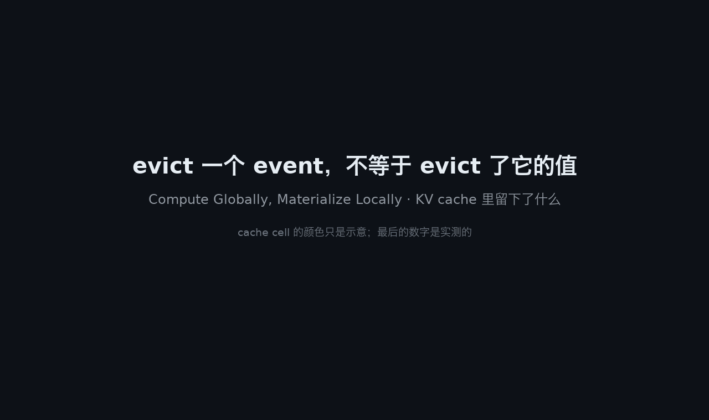
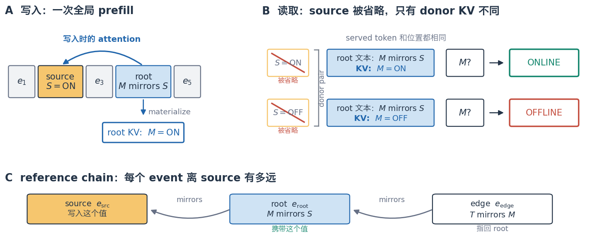
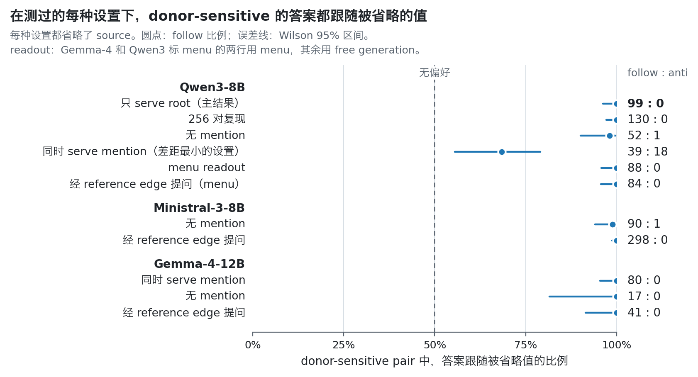
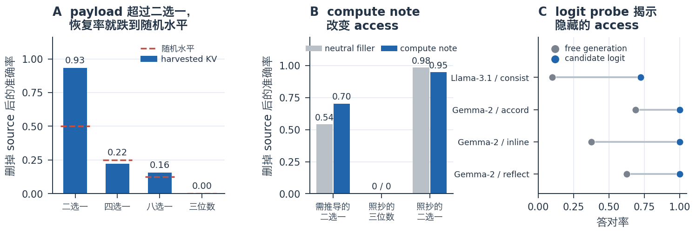
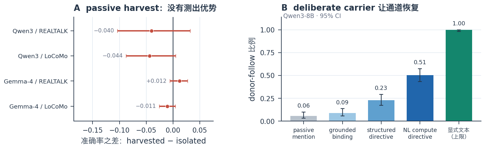
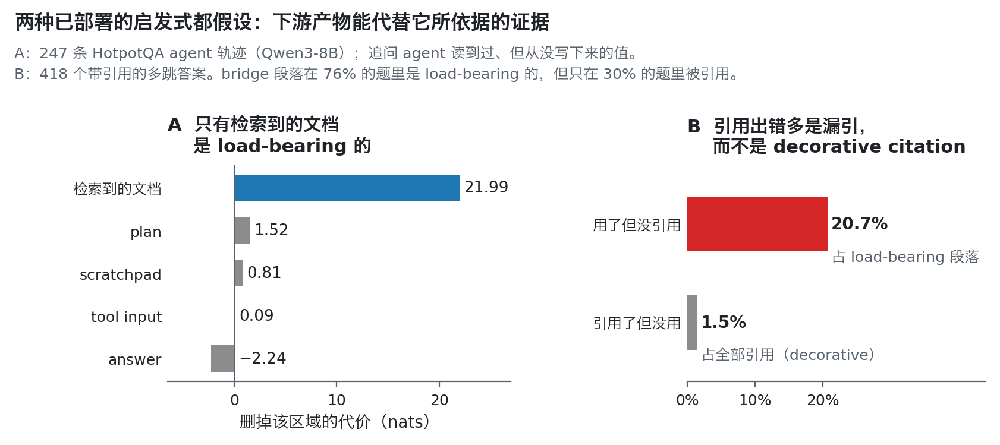

# Compute Globally, Materialize Locally
### The Memory Contract of Sparse Event-KV

**中文** | [English](README.en.md)

[[论文](https://arxiv.org/abs/2607.23693)] [[BibTeX](#引用)]

Zefeng Cai、Zerui Cai · 独立研究者 · 本仓库复现论文中的每一个实验。



*主要结果的示意。cache 格子和它们的颜色是示意性的：表示测量结果意味着什么，不是真实的激活值。最后一幕里的数字是实测的（§3 和 App. J）。由 [`figures/make_kv_demo.py`](figures/make_kv_demo.py) 生成。*

要证明一个缓存的事件可以 evict，常见做法是把它删掉，看准确率有没有掉。这个检查分不清两种情况：这个事件本来就不需要，还是它的值已经活在留下来的那些行里了。我们证明，被删掉的值确实活在那里，并把这称为 **semantic materialization**（语义物化）。所以「删掉之后准确率没掉」并不能说明被删掉的事件是多余的。

<picture>
  <source media="(prefers-color-scheme: dark)" srcset="assets/concept-zh-dark.png">
  
</picture>

<picture>
  <source media="(prefers-color-scheme: dark)" srcset="assets/robustness-zh-dark.png">
  
</picture>

`99:0`：Qwen3-8B 上，donor-sensitive pair 全部跟随被省略的值（*p* = 3.2×10⁻³⁰；256 对的复现里是 130:0） · `6% → 51%`：加一条刻意写入、不含答案的事件后，donor-aligned 恢复率 · `20.7% vs 1.5%`：真正用到却没被引用的段落 vs decorative citation

Agent memory 系列：[VeraKV](https://github.com/oklen/VeraKV)：该把什么交给模型 · [Compute Globally, Materialize Locally](https://github.com/oklen/Compute-Globally-Materialize-Locally)：evict 之后什么还在 · [TracePack](https://github.com/oklen/TracePack)：compaction 之后什么还在

## TL;DR

> 我们删掉答案依赖的那条 observation，只 serve 后面一个文字里从没提到这个值的事件。模型照样用这个值作答：在 donor-sensitive pair 里，Qwen3-8B 上是 **99:0**。

<details>
<summary><b>Abstract</b></summary>

长程 agent 越来越多地把 KV cache 当作 memory 复用：serving 系统保留一部分缓存条目，丢掉其余的。因此各种 eviction 和 episodic memory 方案都建立在一个很少被直接检验的前提上：产生某个事件的那些 observation 不在了之后，这个保留下来的事件仍然有信息量。我们的检验方法是：在其余完全相同的 agent 历史里，把某一条更早的 observation 从 serve 的内容中省略掉。在对这条 observation 敏感的题目里，答案压倒性地跟随被省略的值，尽管 serve 的任何片段都没有说哪个值是对的。我们把这称为 **semantic materialization**：下游事件的缓存行，成了一份可以独立 serve 的计算视图，而这份计算的输入已经不在了。它也可以*刻意*写入。一条措辞经过设计、不含答案的事件，能把 Qwen3-8B 上的 donor-aligned 恢复率从 6% 提高到 51%，而且从不提这个值；相比之下，从长期对话里被动 harvest 自然出现的提及，没有检测到任何优势。这也包括扣下含答案的那一轮时，部署中的检索栈所选出的那些行，而同一路径上的 positive control 是能触发的。harvest 来的行在真实对话上携带的，是它自己的上下文：原位读取时，它对「这一行陈述了什么」的表示，比重新编码同一段文本的保真度更高；这是 fidelity 上的收益，不是 accuracy 上的收益。这样一行能携带什么，是具体而有边界的。模型能读回紧凑的状态，更大的 payload 则衰减到随机水平；一个被携带的状态能不能被读回，取决于措辞，而不只是意思，所以模型理解得一样好的两种措辞，结果可能差得很远。尽管如此，linear probe 在每种措辞下都能在 carrier 行里找到这个状态，所以这些边界限制的是 readout，而不是行里装了什么。由此得到一份稀疏 event-KV serving 的 memory contract：写什么、值落在哪里、source 没了之后还剩下什么。对任何做 eviction 的人来说，推论是：删掉一个 source event、没观察到准确率损失，并不能说明这个 source 是多余的。这些行也很难被 *address*：当前 agent memory 系统里部署的检索阶段，分不清携带值的事件和指向它的事件，所以 eviction 之后留下来的东西，并不因此就能被找到。在真实的长期对话上，一个完整的部署检索栈对单跳问题能很好地找到含答案的那一轮，对多跳问题则不比随机好。如果把这份 contract 当作一项测量而不是一种机制来读，它颠覆了两条已经在部署中的经验法则：agent 自己的 attention 在 eviction 时标记出来的，恰恰是它已经不需要保留的东西；而 citation 失败的主要形式，是漏掉了实际用到的段落，而不是拿没用到的段落来装点答案。

</details>

## 关键发现

agent 的历史只 prefill 一次，所以每个事件的 cache 行都被它之前的所有内容*上下文化*了（图中 A 栏）。而 serve memory 是稀疏的：一次 query 只碰到少数几个事件，系统保留这些行、丢掉其余的，其中经常就包括产生了被问到的那个值的 observation 本身。

所以我们故意丢掉这条 observation。一个事件写下 `register S is ONLINE`；后面的一个 **root** event 只说 `M mirrors S`，不提任何值。我们省略第一个，serve 第二个，然后问 `M` 是什么。serve 的内容里没有任何地方写着 `ONLINE`。模型答 `ONLINE`；当我们把被省略的那条写入翻转过来，它就改答 `OFFLINE`。

这样的一次翻转构成一个 **donor pair**（B 栏）：两段历史在每个 serve 的 token 和位置上都逐字节相同，唯一的差别是*被省略的*那个事件写下的值。如果答案跟着翻转走，就说明 serve 的行携带的不只是它们表面上的文字。只看准确率证明不了这一点，因为准确率把真正的回忆、先验和排除 decoy 混在了一起；所以从头到尾，证据的单位是 donor pair 而不是准确率，decoy 也是独立采样的，而不是答案的补集。

在 donor-sensitive pair 里，答案跟随被省略 source 的比例在 Qwen3-8B 上是 **99:0**（exact sign test，*p* = 3.2×10⁻³⁰）。256 对的复现给出了这个方向背后的普遍程度：256 对里有 131 对 donor-dependent，其中的比例是 130:0。这个方向在各个 serving 格子、各个模型、各种 readout 下从未反转过，我们在任何地方测到的最窄的一格也还是 39:18。跨过去的是状态而不是字符串：一个隐藏的 donor 短语被原样传过去的只有 9.7% 的 pair，和 isolated re-encoding 对照（8%）分不开，而它的语义极性有 64% 传了过去。这是 Qwen3 上的比率：措辞本身能不能跨过去，取决于 checkpoint（Gemma-4 上可以，52:0；App. K）。

我们把这称为 **semantic materialization**：在写入时，把一个来自上游的状态提交进下游事件的表示，而不要求这个事件的 token 原样重复这个状态。

## Memory contract

| 部分 | 内容 | 位置 |
|---|---|---|
| **Trigger** *哪些事件会写入* | 取决于表面形式，而不只是意思（就模型读回的内容而言）。在 16 种 construction 的 bank 上，模型的平均理解率是 .98（最低 .77），write-through（一个输出层面的比率）从随机水平到 .95 不等，**没有一种 construction 能在最近的三个 checkpoint 上都被读回**；而 linear probe 在四个 checkpoint 上、**每一种 construction 下**，都能以 **.99–1.00** 在 carrier 行里找到这个状态（App. J）。readout 必须逐个模型校准，不能想当然。 | §4, App. J |
| **Landing** *值存在哪里* | **root** 携带主要的 donor-aligned 信号。serve 出去的 **reference edge** 离 source 又远一跳，它主要是把 query 引回 root，而不是自己携带这个值。一行能给出什么，取决于和它一起 serve 的是什么。 | §5 |
| **Access** *readout 能拿到什么* | 一个紧凑状态的 readout envelope，而不是一个通用通道。二选一的状态能以 **.934** 读回（随机 .5）；四选一（.223）和八选一（.156）都接近各自的随机水平；三位数从来没被精确读回过（**0/192**）。probe 能以 ≈1.00 从 serve 的行里解码出四选一和八选一的 payload（App. J）：限制在 readout 这一端。 | §6, App. J |

<picture>
  <source media="(prefers-color-scheme: dark)" srcset="assets/envelope-zh-dark.png">
  
</picture>

*Access 的细节。**A**：删掉 source 之后，按 payload 类型的恢复率，与随机水平（虚线）对比。**B**：写入时的 compute note 能改变推导出的判断，但从不改变数值。**C**：在 legacy checkpoint 上，free generation 报出来的比 candidate-logit readout 找到的少。*

## 把这个原语用起来

<picture>
  <source media="(prefers-color-scheme: dark)" srcset="assets/active-zh-dark.png">
  
</picture>

*写入接口的两面。**A**：在真实的长期对话上，harvest 自然出现的提及，相比 isolated encoding 同一段文本，没有检测到优势。**B**：刻意写入的 carrier，同样不提任何值，能把 Qwen3-8B 上的 donor-follow 从 .06 提高到 .51；显式的文本记录是 1.00 的上界。*

**这个原语是可编程的，这就是工程上的抓手。** 一条刻意写入、不含答案的 carrier 事件，能把 Qwen3-8B 上的 donor-aligned 恢复率从 **6% 提高到 51%**，而且从不提这个值。把 query 固定在一个绝对位置时，只 serve 共享的下游行得 .00；在它旁边加上 carrier，用自然语言 compute directive 时得 .42，用显式文本记录时得 1.00。一个状态如果在它的操作数离开 serving set 之后还要用到，就可以刻意地提交进去，逐个 checkpoint 校准，并以显式文本作为可靠的 fallback。

**Passive harvest 不是可靠的接口。** 在 REALTALK 和 LoCoMo 的长期对话上，从完整历史的 cache 里 harvest 后面自然出现的提及，相比 isolated encoding 同一段文本，没有可检测到的好处。在 Gemma-4 上按原始位置原生 serve 时（这正是 eviction 式系统实际呈现给模型的几何结构），LoCoMo 那一格在 ±.05 的范围内与 isolated encoding *等价*（−.011，95% CI [−.026, +.004]）。上面的受控 arm 用的是合成的 donor-paired 轨迹；自然对话上的结果界定了它们能推广到多远。

## 给做 eviction 的人

如果一个 ablation 删掉了一个 source event，没观察到准确率损失，它并没有证明这个 source 是多余的：它可能保留了一行本来就携带答案的内容。这样一来，修正就应该以 serve 的 patch 的形式进行，而不是重新计算；这恰好也是便宜的方向（在 *L* = 9.2k 时，追加一个 patch 要 77 ms，重新计算要 1033 ms）。

## v2 新增了什么（2026 年 10 月）

- **Capacity 不等于 addressability**（§7, App. H）。文本索引分不清携带值的事件和指向它的事件：BM25 在每一题上给 root 和 edge 打出逐位相同的分数。在 LoCoMo 上，一个部署中的检索栈（BM25、Qwen3-Embedding-0.6B、RRF、bge-reranker-v2-m3）对单跳问题能找到含答案的那一轮，对多跳问题则不比随机好。
- **部署的 retriever 选出的行**（§8, App. I）。扣下所有含答案的轮次时，harvest 的 KV 并不比 isolated encoding 好（−.017，95% CI [−.042, +.010]，n = 1269），而修好的同路径 positive control 能触发（+.018，p = .040）。harvest 的行真正携带的是它自己的上下文：当它陈述答案时，比 joint re-encoding 高 +1.87 log-odds；value swap 表明这个收益跟着证据走（interaction +2.97）。
- **推论**（§9）。在 247 条 HotpotQA agent 轨迹上，检索到的文档是唯一 load-bearing 的区域；agent 在写入过程中积累的 attention，标出的是不需要保留的东西；citation 失败的主要形式是遗漏（20.7% 的 load-bearing 段落没被引用），而不是装饰（1.5%）。
- **行里装了什么 vs 模型读出了什么**（App. J–L）。在包括 Qwen3-32B 在内的四个 checkpoint 上，每种 construction 下 carrier 行都装着这个状态；模型读不回来的 payload，线性地存在于 serve 的行里；意思在每个 checkpoint 上都能跨过去，措辞只在部分 checkpoint 上能；在 AMA-Bench 上，gather 的 KV 携带的是未被选中的那些 turn 的影响，而不是它们的信息。

<picture>
  <source media="(prefers-color-scheme: dark)" srcset="assets/consequences-zh-dark.png">
  
</picture>

*推论（§9）。**A**：在 247 条 HotpotQA agent 轨迹上，只有检索到的文档删掉的代价大（21.99 nats，其他任何区域最多 1.52），而 region-aware 的 eviction 调度恰恰给它们低优先级、快衰减。**B**：在 418 个带 citation 的多跳答案里，citation 失败多是漏掉了实际用到的段落，远多于引用了没用到的段落。*

## 环境

```bash
pip install -r requirements.txt              # 2025 年的软件栈：torch 2.4.1 / transformers 4.51.3
export SPRAG_MODEL_PATH=/path/to/Qwen3-8B     # 本地的 HuggingFace 模型目录（见「模型」）
```

**具体的 checkpoint、dtype、两套环境（2026 年的 Gemma-4 运行需要单独的 transformers-5 环境）、GPU、环境变量，以及实验 → 图 / 表的对应关系，都在 [MODEL_AND_ENV_MANIFEST.md](MODEL_AND_ENV_MANIFEST.md) 里。**

每个实验都是一个模块，在仓库根目录用 `PYTHONPATH=. python -m kvmemory.<name>` 运行；结果写到 `--out` 指定的路径（默认在 `./out/` 下）。全程 greedy decoding；冻结的模型通过它原生的接口恢复状态，不做 fine-tuning，也没有训练过的 reader。近期的这些模型一张 GPU 就够了。

### 模型

把 `SPRAG_MODEL_PATH` 设为一个本地 HuggingFace 目录。论文里承载主要结论的近期模型是 **Qwen3-8B**、**Ministral-3-8B** 和 **Gemma-4-12B**；另外四个 2024 年的 checkpoint（**Qwen2.5-7B**、**Gemma-2-9B**、**Mistral-7B-v0.3**、**Llama-3.1-8B**）只作为探索性的 legacy 诊断出现。大多数实验跑在 Qwen3-8B 上；2026 年的、长上下文的 checkpoint 可能需要 chunked prefill（`export SPRAG_ENCODE_CHUNK=4096`）和较新的 `transformers`。每个模型都在一个冻结的 revision 上评测，所以结论是 checkpoint 层面的，而不是模型家族层面的。v2 的 probe（App. J、L）加上了 **Qwen3-32B**，一张 80 GB 的卡放得下。

真实对话的检索运行（§7、App. I）还需要 **Qwen3-Embedding-0.6B** 和 **bge-reranker-v2-m3**，作为 `./models/` 下的本地目录（用 `--model-dir` 可以指定别的根目录）；合成的 addressability 运行从 `SPRAG_EMBED_PATH` 读取 embedding 模型。有几步要调用 OpenAI 兼容的 LLM endpoint（LLM 写的 hard negative、对提及 turn 的 LLM 标注、跨模型家族的 re-judge、graph ingestion）；设置 `JUDGE_BASE_URL`、`JUDGE_API_KEY` 和 `JUDGE_MODEL`（见 `kvmemory/llm_api.py`）。revision 和环境见 manifest 文件。

### 数据

合成实验不需要数据。其他实验从 `./data/` 读取（见 [data/README.md](data/README.md)）：

- **LoCoMo**：`locomo10.json`（公开；放在 `./data/locomo10.json`）。用于 X8 审计、§7 检索、App. I。
- **REALTALK**：只许可用于评测；**需要单独获取**，放在 `./data/REALTALK` 下。用于 X8 审计和修好的对照。
- **HotpotQA**：distractor 验证集，JSONL 格式，放在 `./data/hotpotqa/hotpot_dev_distractor.jsonl`。用于 §9。
- **AMA-Bench**：测试集，JSONL 格式，放在 `./data/ama_test.jsonl`。用于 App. L。

## 实验 → 脚本

| 论文章节 | 脚本 |
|---|---|
| **Discovery**：donor pair 99:0、swap probe、overwrite | `kv_causal`、`kv_phantom` |
| **Trigger**：16 种 construction 的 write bank（mirror 和 flag 两族）、logit probe；控制长度和背景后的重跑 | `kv_parabank`、`kv_bankprobe`、`kv_parabank2` |
| **Landing**：2×2 factorial、真正的 reference edge、X11 position control、多跳 | `kv_causal2`、`kv_causal3`、`kv_poscontrol`、`kv_vardecomp`、`kv_hops`、`kv_refcarrier` |
| **Access**：cardinality envelope、orthogonal bits、capacity、digits、compute note、decoy 审计 | `kv_sweepmenu`、`kv_orthobit2`、`kv_bicap`、`kv_digit`、`kv_noteknob2`、`kv_decoyctl2` |
| **Programming**：X9 carrier arm；X10 serve-set ablation | `kv_mater2`、`kv_mater3` |
| **真实对话压力测试**：X8 coverage 审计、harvest、注入 carrier 的对照；原生 serving（原位置、key mask）vs compact 路径 | `x8_audit2`、`kv_harvest3`、`kv_harvest4`、`kv_harvnative` |
| **Update side**：patch vs 重新计算、计时 | `kv_coherence2`、`kv_recomp`、`kv_timing` |
| **Faithfulness gates**：KV 路径兼容性、数值 + top-1 margin（App. A）；Gemma-4 sliding-window oracle（App. D） | `kv_ident`、`kv_identm`、`kv_swgate` |
| 稳健性（冻结 seed / 未调过的模板） | `kv_frozen` |
| **Capacity 不等于 addressability**（§7, App. H）：oracle vs retriever 的 serve set、root/edge position control、reference arm | `kv_addr`、`kv_addr_e2e` |
| **真实对话检索排序**（§7；"E1"）：V/M turn 标签、LLM 标签、五 arm 检索栈、mention-row 的后续实验、graph arm 及其 planted-row 检验 | `rA_roles`、`rA_loose`、`rA_loose2labels`、`rA_rank`、`rA_mpos`、`rA_graph`、`rA_graph_plant` |
| **保留行 vs summary**（§7）：TTFT 和存储 | `kv_econ` |
| **修好的 positive control**（§8, App. I；"E3"）：LLM 写的 hard negative、forced-choice readout、整段对话的 counterfactual、placebo carrier；readout 和排序检查 | `kv_e3negs`、`kv_e3ctrl`、`kv_e3probe`、`kv_e3clean`、`kv_e3rank` |
| **retriever 选出的行**（§8, App. I；"E2"）：扣下值的 serve set、六个 arm、区间、跨家族 re-judge、statistical power；log-odds readout、budget sweep、chain-of-thought、hot window、floor arm | `kv_e2sets`、`kv_e2`、`kv_e2stats`、`kv_e2_rejudge`、`kv_e2power`、`kv_e2negs`、`kv_e2ro`、`kv_e2k`、`kv_e2cot5`、`kv_e2hot`、`kv_e2hot2`、`kv_e2floor` |
| **窄形式及其代价**（§8, App. I）：natural serve set、value swap、延迟 | `kv_e2natsets`、`kv_e2swap`、`kv_e2cost` |
| **表示层面的 drift**（§8, App. I）：两个 world 之间逐 turn 的 KV drift、delimiter vs 内容 | `kv_e3div`、`kv_e3div2`、`kv_e3div3` |
| **推论**（§9）：HotpotQA agent 轨迹、区域 ablation 和 source counterfactual（也对应「为什么删掉 source 很少损失准确率」那一段）、按 attention 排序的 eviction、把答案 KV 当 session memory、counterfactual citation 检查 | `kv_traj`、`kv_hnegs`、`kv_region`、`kv_dens`、`kv_ans`、`kv_cite` |
| **Carrier 行 probe**（App. J）：16 种 construction 的 bank、设计 A/B、四个 checkpoint | `kv_pbprobe` |
| **Payload probe vs 模型的 readout**（App. J） | `kv_payprobe2`（Gemma-4 用 `kv_payprobe3`）、`kv_payprobe`、`x3_readout` |
| **意思 vs 措辞**（App. K） | `kv_phantom2` |
| **AMA-Bench side channel**（§8, App. L）：8B 和 32B reader | `kv_sidechannel2`、`kv_sidechannel3`，基于 `kv_sidechannel`、`kv_scope`、`kv_equiv` |

**共享模块：** `llm_hf`（HF backend + KV 复用）、`kv_matrix`（KV encode / assemble 工具）、`kv_select_smoke`（chat template 包装）、`kv_vartrack`（step 词表模板）、`kv_fail2`（forced-choice logit probe）、`cross_judge`（LLM judge）。v2 新增：`llm_api`（OpenAI 兼容 endpoint）、`embed`（Qwen3-Embedding-0.6B）、`rA_arms`（检索栈）、`locomo`（LoCoMo loader），以及 AMA-Bench harness `ama_bench`、`components`、`core`。

**分析。** `analysis/` 里是把模块输出变成 v2 数字的脚本；把输出复制进去之后，在 `analysis/` 目录里运行。[analysis/README.md](analysis/README.md) 列出了每个脚本的输入，以及它报告的是论文里的哪一部分。

**图。** `python figures/make_all.py` 根据 `figures/data/` 和脚本里的数字，重画本页的每一张图（浅色/深色，英文/中文各一套）；[figures/README.md](figures/README.md) 列出了每张图对应的脚本，以及数字来自论文的哪一部分。

每个脚本的模块 docstring 里都有一个可运行的例子，例如：

```bash
SPRAG_MODEL_PATH=/path/to/Qwen3-8B CUDA_VISIBLE_DEVICES=0 \
    python -m kvmemory.kv_causal --items 24 --seed 3900 --out ./out/cz.json
```

## 引用

```bibtex
@misc{cai2026materialize,
  title  = {Compute Globally, Materialize Locally: The Memory Contract of Sparse Event-KV},
  author = {Cai, Zefeng and Cai, Zerui},
  year   = {2026},
  note   = {https://arxiv.org/abs/2607.23693}
}
```

## 许可

MIT，见 [LICENSE](LICENSE)。
